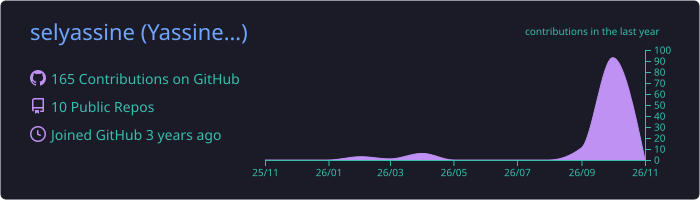
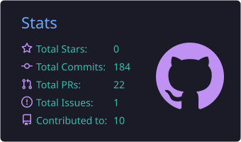
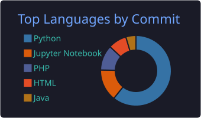
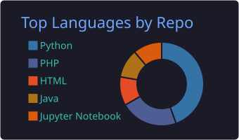
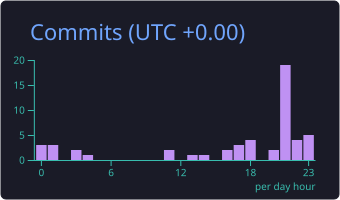

<!-- Bannière -->
<p align="center">
  
</p>

<!-- Texte animé -->
<p align="center">
  <a href="https://github.com/selyassine">
    
  </a>
</p>

<p align="center">
  
  
  
</p>
<p align="center">
  
  
  
  
  
</p>

---

### 👨‍💻 À propos

```python
class YassineSelmi:
    formation  = ["Ingénieur Data Science — ESPRIT, Tunis",
                  "Master Actuariat — Le Mans Université"]
    diplome    = "août 2027"
    expertise  = ["IFRS 17", "Provisionnement (Chain Ladder, Mack, BF)",
                  "Solvabilité II", "Tarification GLM", "Valeurs extrêmes"]
    data_ia    = ["Machine learning", "LLM & RAG", "Agents (LangGraph)", "MLOps"]
    principe   = "Le code calcule, le modèle de langage explique, chaque chiffre est vérifié."
```

- 🎯 Je construis des outils qui relient la **rigueur actuarielle** et le **machine learning moderne**.
- 🔭 En ce moment : **IFRS 17 Copilot**, un copilote multi-agent qui produit des notes actuarielles citées et vérifiées.
- 🌱 J'approfondis : théorie des valeurs extrêmes, agents LLM fiables, évaluation rigoureuse des modèles.
- 🤝 Ouvert aux **stages et opportunités** en actuariat, data science et IA appliquée à l'assurance.

---

### 🚀 Projets phares

| | Projet | Point fort | État |
| :-: | --- | --- | --- |
| 🧾 | [**IFRS 17 Copilot**](https://github.com/selyassine/ifrs17-copilot) | CSM identique **au centime sur 50/50 dossiers** contre un script R indépendant · 370+ tests |    |
| 🚗 | [**SIAP**](https://github.com/selyassine/SIAP) | Tarification GLM + LightGBM, fraude (AUC ≈ 0,82), IBNR Chain Ladder / Mack / Bootstrap, vision YOLOv8 |   |
| 🧬 | [**VitaAI**](https://github.com/selyassine/VITA) | 15 modules d'assurance-vie : Lee-Carter, SCR sur courbes EIOPA, VaR de longévité à 99,5 % |   |
| 📈 | [**QuantAI**](https://github.com/selyassine/Quant) | Ensemble LightGBM + LSTM + Transformer, Markowitz, Black-Litterman, agent avec validation humaine |   |
| ⚙️ | [**Titanic MLOps**](https://github.com/selyassine/Mlops) | GitHub Actions → GHCR → Jenkins → Prefect, automatiquement à chaque push |   |

---

### 🎓 Formation et certifications

<table>
<tr>
<td align="center" width="25%"><br><sub>Tunis · 2022 – 2027</sub></td>
<td align="center" width="25%"><br><sub>2025 – 2027</sub></td>
<td align="center" width="25%"><br><sub>en cours</sub></td>
<td align="center" width="25%"><br><sub>en cours</sub></td>
</tr>
</table>

---

### 🧰 Technologies

<p align="center">
  <br>
  <br>
  
</p>

<p align="center">
  
  
  
  
  
  
  
  
  
  
</p>

<details>
<summary><b>📐 Compétences actuarielles en détail</b></summary>
<br>

| Domaine | Méthodes |
| --- | --- |
| **IFRS 17** | Modèle général, PAA, CSM, ajustement pour risque, passif pour sinistres survenus |
| **Provisionnement** | Chain Ladder, Mack, Bornhuetter-Ferguson, Bootstrap ODP |
| **Solvabilité II** | SCR (mortalité, longévité, taux), courbes EIOPA, ORSA, ALM |
| **Tarification** | GLM Poisson et Gamma, machine learning (LightGBM, XGBoost), audit d'équité SHAP |
| **Assurance-vie** | Tables de mortalité Lee-Carter, provisions mathématiques, VaR de longévité |
| **Risques extrêmes** | Théorie des valeurs extrêmes |

</details>

---

### 📊 Statistiques GitHub

<p align="center">
  
</p>
<p align="center">
  
  
</p>
<p align="center">
  
  
</p>
<p align="center">
  
</p>
<p align="center">
  
</p>

<!-- Animation du serpent : générée chaque jour par .github/workflows/snake.yml -->
<p align="center">
  <picture>
    <source media="(prefers-color-scheme: dark)" srcset="https://raw.githubusercontent.com/selyassine/selyassine/output/github-contribution-grid-snake-dark.svg">
    
  </picture>
</p>

<!-- Pied de page -->
<p align="center">
  
</p>
